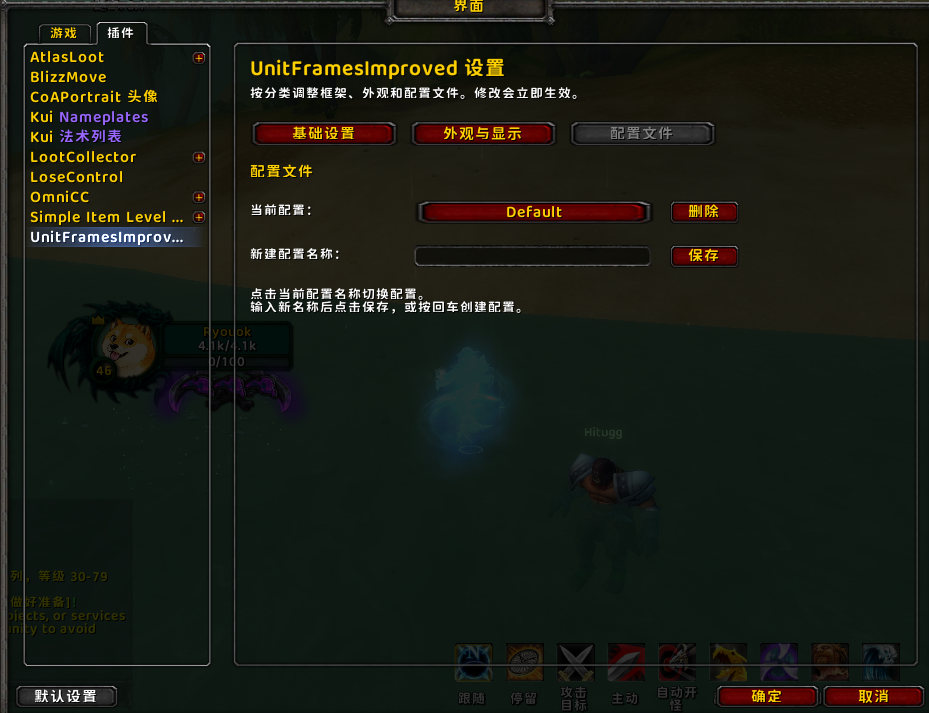
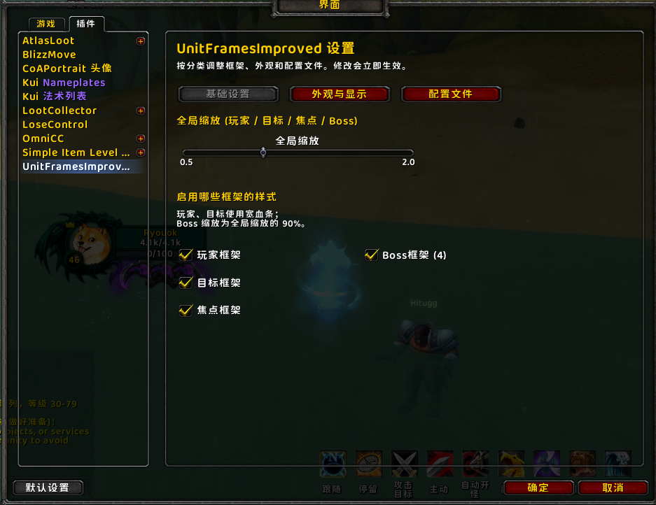
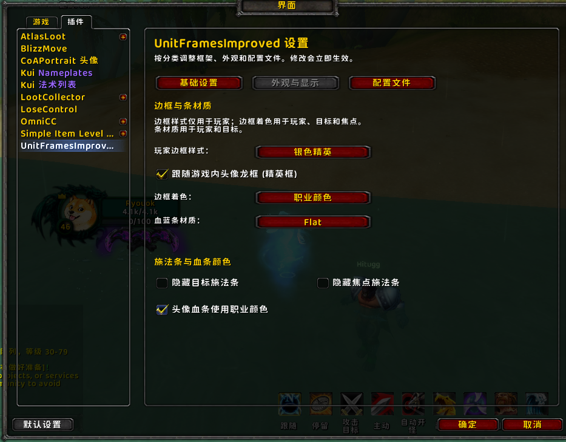
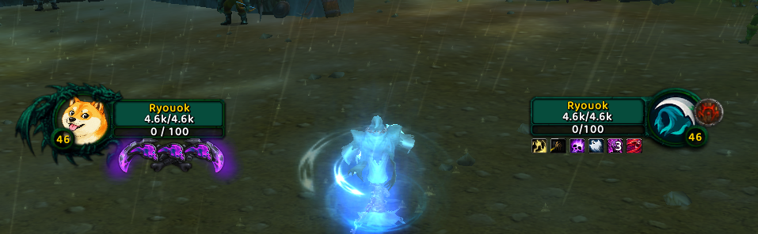
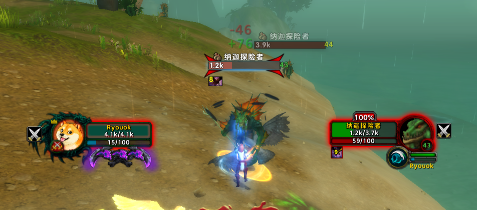
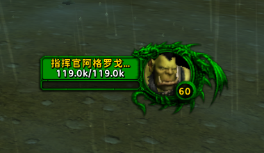
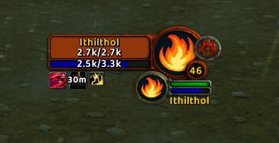
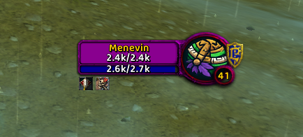

# UnitFramesImproved-CN

飞升魔兽头像框体插件 UnitFramesImproved，在黑猫汉化的基础上加以修复整合以适用于 Arden 版本。

## 安装

下载并解压仓库，将其中的 `UnitFramesImproved` 文件夹复制到游戏的 `Interface/AddOns`。进入游戏后，在「界面 → 插件 → UnitFramesImproved」中配置。

插件支持玩家、目标、焦点和首领框架的样式调整，以及边框、血条材质和配置文件管理。小队框架保留游戏默认样式。截图中的自定义头像由 CoAPortrait 提供，本仓库不包含该插件。

## 游戏截图

### 配置文件

### 基础设置

### 外观与显示

### 玩家和目标框架

### 战斗中的框架

### 首领框架

### 目标及目标的目标

### 目标框架配色

